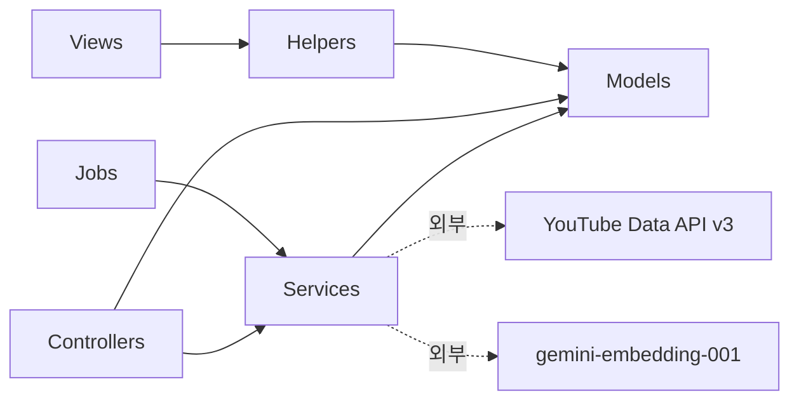
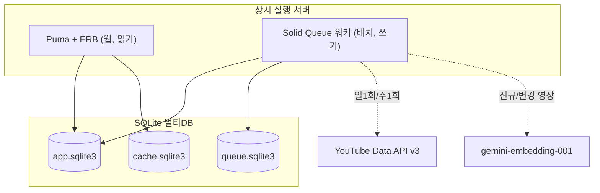
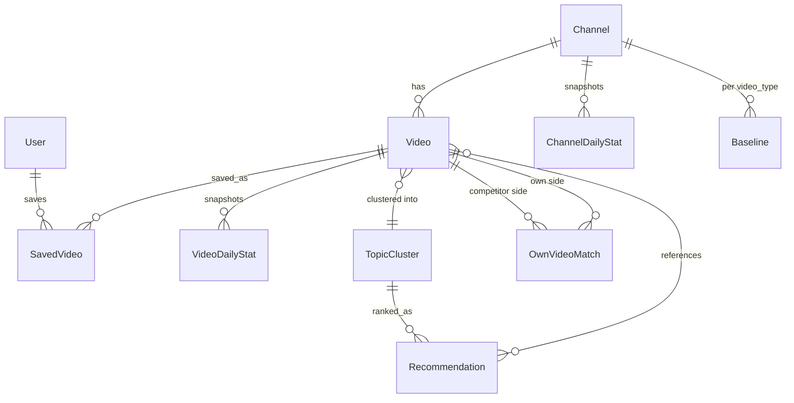

# Architecture Spine — SPARTA Content Lab

## Design Paradigm

**Layered + Pipes-and-Filters.** 웹·큐 두 실행 경로가 같은 도메인 위에 앉는다.

- **Layered** — 요청 경로는 `Controller → View(ERB) → (읽기 전용) Model`. 도메인·계산 로직은 컨트롤러·뷰·잡 어디에도 두지 않고 `app/services`가 단일 소재지다. 화면은 배치가 물질화한 값을 읽기만 한다.
- **Pipes-and-Filters** — 수집·채점은 순서가 곧 의존인 필터 체인이다. 각 필터는 이전 단계 산출을 DB에서 읽어 다음 산출을 DB에 쓴다. 잡이 중간에 죽어도 이미 쓴 단계는 남는다.

레이어 → 디렉터리 매핑.

| 레이어 | 디렉터리 | 역할 |
| --- | --- | --- |
| 웹(표현) | `app/controllers`, `app/views`, `app/helpers` | 읽기 전용 렌더. 계산 금지 |
| 서비스(도메인) | `app/services/youtube`, `app/services/scoring`, `app/services/embedding` | 외부 호출·계산의 유일한 경계 |
| 배치(오케스트레이션) | `app/jobs` | 필터 체인 순서만 조립. 로직은 서비스 위임 |
| 영속 | `app/models`, `db/` | AR 모델·스키마. 파생값은 물질화 컬럼 |

## Invariants & Rules

의존 방향은 아래를 절대 거스르지 않는다. 화살표는 "의존해도 되는 방향"이다.



Model·View·Helper는 Service를 부르지 않는다. Service는 Controller·Job을 모른다. 외부 네트워크 호출은 오직 Service 경계에서만 난다.

### AD-1 — YouTube API 단일 클라이언트 경계

- **Binds:** FR-1, FR-2, FR-4 / 제약1·10
- **Prevents:** 쿼터 회계·지수 백오프·nil 방어가 여러 호출부에 흩어지는 것.
- **Rule:** 모든 YouTube Data API 호출은 `app/services/youtube/*`를 통과한다. 컨트롤러·모델·뷰·잡에서 `Net::HTTP`/SDK로 직접 호출 금지. 이 경계가 **단일 쿼터 원장**이다 — 공유 1만 units 풀과 `search.list` 별도 버킷(하루 100콜, 콜당 1 unit)을 각각 회계하고, 재시도 소비분까지 포함해 두 파이프라인(AD-11)이 예산을 이중 계상하지 않게 한다. 배치 크기(50)도 이 경계 안에서만 관리한다.

### AD-2 — 스코어링 서비스 단일 소재지 + 지표 정의

- **Binds:** FR-5, FR-6, FR-7, FR-19, FR-21
- **Prevents:** 기준선·배수·기회 점수 공식이 뷰·잡·모델에 복제되어 튜닝 시 다곳 수정. 성과 배수·기회 점수·동점 처리가 개발자마다 다르게 구현되는 것.
- **Rule:** 기준선·성과 배수·플루크 방어·기회 점수 정규화는 `app/services/scoring/*`에서만 계산한다. 지표 정의를 못박는다.
  - **성과 배수 = 영상 현재 누적 `view_count` ÷ (같은 채널·같은 `video_type` 최근 N개 공개 영상 `view_count`의 중앙값)** — 평균 아님, age-matched 아님(소급 불가라 MVP는 누적, FR-24가 편향 명시).
  - **기회 점수** = 4개 입력(성과 배수 신호·경쟁 공통성·콘텐츠 갭·최신성)을 각각 [0,1]로 정규화 → 가중합 → ×100. 이 **구조는 불변**이고 정규화 매핑·가중치 **값만** AD-4 설정이다. 성과 배수 하나로 대체되지 않는 별도 종합 지표다.
  - **결정적 동점 처리** — 기회 점수 동점 시 성과 배수, 그다음 최신성 순. 순서는 코드에 고정한다.
  - 성과 배수(성과)와 VPD(모멘텀)를 하나의 종합 점수로 합산하지 않는다(별도 축).

### AD-3 — 무거운 파생 지표는 배치 물질화

- **Binds:** FR-5, FR-8, FR-17, FR-18, FR-19, FR-21 / NFR 성능
- **Prevents:** 대시보드 요청당 재계산으로 P95 2초(PRD §8) 위반.
- **Rule:** 성과 배수·기회 점수·콘텐츠 갭 버킷·자사 유사영상 판정은 배치에서 계산해 DB 컬럼/테이블에 물질화한다. 웹 요청 경로는 물질화된 값을 읽기만 하고 임베딩·유사도·중앙값을 재계산하지 않는다.

### AD-4 — 튜닝값은 단일 설정으로 격리

- **Binds:** FR-5, FR-6, FR-13, FR-21, FR-22, FR-23 / Open Q1-5·7
- **Prevents:** 아키텍처가 미확정 실데이터 튜닝값을 코드 상수로 하드코딩해 조기 확정하는 것.
- **Rule:** 기준선 N·유사도 τ·기회 점수 가중치와 정규화 매핑·에버그린 나이/배수 임계·조회수 하한(고정값·k)·구독자 규모 임계·극단배수(25x)·위젯별 전환 스냅샷 수·**is_short duration 임계(AD-8)**는 코드가 아니라 단일 설정(`config/scoring.yml` 등)에서 읽는다. 값은 본개발 실측이고 스파인은 자리만 고정한다.

### AD-5 — 일별 스냅샷이 모든 시계열의 단일 원천

- **Binds:** FR-3, FR-7, FR-12, FR-14, FR-22
- **Prevents:** 시계열 지표가 원천 없이 파생값을 추정하는 것.
- **Rule:** `video_daily_stats(video_id, date, view_count)`·`channel_daily_stats(channel_id, date, subscriber_count)`가 VPD·검증 에버그린·구독자 증감·스파크라인의 유일한 원천이다. `(video_id, date)`·`(channel_id, date)`는 유니크 — 같은 날 중복 행이 생기지 않는다.

### AD-6 — 90일 이후 주단위 롤업

- **Binds:** FR-3
- **Prevents:** 스냅샷 핫셋 비대로 인한 쿼리 성능 저하.
- **Rule:** 최근 90일은 일단위 유지, 이후는 주단위 집계 테이블로 롤업 후 원본 삭제 + 주기 `VACUUM`. 일일 잡에 동승한다. 한계 — 90일 이전 구간은 일단위 정밀도가 없다(장기 에버그린 검증 불가, 2~3주 승격 창에는 무관).

### AD-7 — 콜드스타트는 위젯별 준비도로 판정

- **Binds:** FR-23, FR-7, FR-12, FR-14, FR-22
- **Prevents:** 전역 배너 하나가 1일차 동작 지표(성과 배수·에버그린 후보·콘텐츠 갭·추천 3개)까지 "수집 중"으로 가리는 것.
- **Rule:** 각 시계열 위젯은 "요구 스냅샷 수 충족 여부"를 독립적으로 판정해 준비/수집중 상태를 개별 반환한다. 전역 콜드스타트 플래그 하나로 뭉개지 않는다. 위젯별 최소 스냅샷 수는 AD-4 설정에서 읽는다.

### AD-8 — 쇼츠/롱폼 완전 분리 + is_short 불변 캐시

- **Binds:** FR-5, FR-25 / 제약2
- **Prevents:** 합산 기준선이 롱폼을 저성과로, 쇼츠를 고성과로 체계 오탐하는 것(channel-analysis §6 실측 — 쇼츠 중앙값이 롱폼의 2.7배).
- **Rule:** 기준선·필터·표시에서 쇼츠와 롱폼을 절대 혼합하지 않는다(중앙값을 공유하지 않는다). `is_short`는 **수집 경계의 유일 writer(`Youtube::ClassifyShort`)가 영상 최초 저장 시 1회** duration 휴리스틱으로 판정해 DB에 캐시하고 이후 불변으로 취급한다(두 writer/두 임계 금지). duration 임계는 AD-4 설정에서 읽는다. `/shorts` 프로브 보정은 post-MVP(IP 차단 위험).

### AD-9 — 회원 전용/누락 통계는 nil 방어

- **Binds:** FR-5, FR-6, FR-17 / 제약3
- **Prevents:** 가려진 조회수가 중앙값·배수 계산을 오염시키거나 파이프라인을 중단시키는 것.
- **Rule:** 회원 전용 영상은 `view_count` nil로 저장하고 기준선 표본·성과 비교에서 제외한다. `like_count`/`comment_count` 누락도 동일하게 nil 방어한다. 자사 코스(회원 전용) 영상은 제목·주제 매칭까지만 되고 성과 수치는 표시하지 않는다(API 강제 한계).

### AD-10 — 임베딩은 BLOB + Ruby 코사인, 제목 변경 시만 재생성

- **Binds:** FR-17, FR-20
- **Prevents:** 매 배치 전량 재임베딩 과금, 네이티브 확장 배포 리스크.
- **Rule:** 임베딩은 `videos`의 BLOB 컬럼에 저장하고 주1회 배치에서 메모리로 올려 Ruby 코사인으로 유사도를 계산한다(sqlite-vec 미채택, 벡터 5만 초과 시 전환). 영상당 1회 생성하되 `embedding_source_hash`(제목 기준)가 바뀐 행만 재생성한다. 자사 유사영상 판정과 주제 자동 묶기는 같은 임베딩을 재사용한다(추가 임베딩 비용 0). **주제 클러스터(연결요소)는 배치마다 재계산되는 휘발성**이므로, `Recommendation`은 휘발 클러스터에 FK하지 않고 생성 시점의 `reference_video_ids` + `topic_label`을 스냅샷으로 저장한다(재라벨링돼도 추천이 댕글링되지 않음).

### AD-11 — 수집·발굴 두 파이프라인 분리

- **Binds:** FR-1, FR-4
- **Prevents:** 발굴의 `search.list` 100콜/일 병목이 일일 갱신을 막는 것.
- **Rule:** 일1회 수집·채점(`DailyCollectionJob`)과 주1회 발굴(`WeeklyDiscoveryJob`)을 분리된 Solid Queue recurring으로 운용한다. 일일 체인 순서 = `channels.list → playlistItems.list → videos.list → 스냅샷 저장 → 기준선/성과 배수 → 에버그린 후보 → 임베딩(신규/변경) → OwnVideoMatch(자사 유사영상) → 콘텐츠 갭 버킷 → 주제 클러스터 → 기회 점수 → 추천 3개`. 이 순서가 곧 스테이지 의존이다 — **콘텐츠 갭은 OwnVideoMatch 없이 계산할 수 없고, OwnVideoMatch는 임베딩 이후**다. 각 스테이지는 이전 산출을 DB에서 읽어 다음 산출을 쓴다(한 파생값의 writer는 한 스테이지뿐).

### AD-12 — SQLite 멀티DB + WAL

- **Binds:** NFR 동시성 / 제약6
- **Prevents:** 큐 쓰기와 앱 쓰기의 경합, 배치 쓰기 중 웹 읽기 블로킹.
- **Rule:** 앱데이터 / Solid Queue / Solid Cache를 별도 SQLite 파일로 분리한다(Rails 8 멀티DB). WAL + `busy_timeout 5000ms`(Rails 8 기본). 단일 라이터이므로 배치 트랜잭션은 짧게 — API 호출을 트랜잭션 밖에 두고 배치 삽입한다. Redis 없음.

### AD-13 — 잡 관측성은 DB 이력 + 지수 백오프

- **Binds:** NFR 관측성 / 제약10
- **Prevents:** 수집 실패가 조용히 묻히는 것.
- **Rule:** 수집·발굴 잡의 실행 이력(시작·성공·실패·재시도·쿼터 사용량)을 `job_runs` 테이블에 기록해 운영자가 DB로 확인한다. API 실패(403 quota/rate)는 지수 백오프로 재시도한다. 재시도는 일1회 갱신 상한에 포함되지 않는다.

### AD-14 — 인증은 Rails 8 제너레이터 `[ADOPTED]`

- **Binds:** NFR 접근보호 / Open Q6
- **Prevents:** 내부 도구의 미인증 접근.
- **Rule:** `bin/rails generate authentication`이 만드는 `User`·세션·`has_secure_password`를 쓴다. 운영 2인을 seed로 등록한다. 멀티테넌시·외부 회원 관리는 범위 밖(§5 Non-Goal). 목업의 아바타 2인이 `User`와 정합한다.

### AD-15 — 프론트는 ERB partial + helper, 토큰은 DESIGN.md 단일 원천 `[ADOPTED]`

- **Binds:** FR-8~FR-26 표시 / DESIGN.md
- **Prevents:** 세션마다 색·간격·radius를 재추정해 6화면이 어긋나는 것.
- **Rule:** 공유 위젯(성과 배수 셀·뱃지·정직성 상태·테이블 행)은 `app/views/shared/_*.html.erb` + `app/helpers`로 캡슐화한다(예 — DESIGN.md §10 `performance_band_class`). DESIGN.md §10 토큰을 `config/tailwind.config.js`의 `theme.extend`로 이관하고, 원시 Tailwind 색(`blue-600` 등) 직접 사용을 금지한다. "구독자 대비 조회수" 라벨은 전부 "성과 배수(채널 평소 대비)"로 통일한다(PRD §11). 추가로 두 표시 불변식을 강제한다.
  - **다국어(DESIGN.md §7)** — 제목·채널명이 들어가는 모든 셀에 폰트 폴백·`word-break:keep-all`·line-clamp/truncate+`title` 툴팁·`min-w-0`·`lang` 힌트를 적용한다(한·일 혼재 제목은 실데이터에서 반드시 넘친다).
  - **정렬·레이아웃** — 대시보드 기본 정렬키는 성과 배수 내림차순(raw 조회수 기본 정렬 금지), 기본 레이아웃은 구독자 밴드 그룹핑 + 밴드 내 배수 정렬. 성과 배수는 히어로 셀, raw 조회수는 2차 뮤트 컬럼(PRD §9 제약9·FR-8).

### AD-16 — 정직성 상태는 숨기지 않고 자리 유지

- **Binds:** FR-6, FR-13, FR-14, FR-22, FR-23, FR-24 / NFR 정직성
- **Prevents:** 불확실성(콜드스타트·측정한계·후보 vs 검증·저신뢰·시점 편향)을 은폐하는 것.
- **Rule:** 정직성 상태는 위젯을 숨기지 않고 자리를 유지한 채 상태를 표시한다(DESIGN.md §4.7). AD-7(위젯 준비도)·AD-8(유형 분리)·AD-9(회원 nil)의 UI 표면이다. 두 정직성 규칙을 명시한다.
  - **FR-24 시점 편향** — 성과 배수 옆(또는 툴팁)에 누적 조회수 기준·편향 안내를 둔다. **두 기전을 모두 명명**한다 — (1) 현재 누적 조회수 사용, (2) 기준선을 최근 N개(젊고 저조회) 영상으로 잡아 오래된 영상 배수를 추가로 부풀림. 에버그린 판정(FR-13/14)이 이를 상속함을 안내한다.
  - **FR-19 추천 정직성** — 자격 주제가 3개 미만이면 억지로 3개를 만들지 않고 "이번 주 N개 확보"로 정직하게 표시한다.

### AD-17 — 스냅샷 DB는 백업이 필수

- **Binds:** AD-5 / NFR 가용성 / 제약5
- **Prevents:** `app.sqlite3` 파일 소실 시 시계열의 영구 손실(스냅샷은 소급 재구성 불가).
- **Rule:** `app.sqlite3`(스냅샷 원천)는 일일 백업을 운영 필수로 둔다(예 — SQLite Online Backup API 또는 litestream류 연속 복제). `queue`/`cache` DB는 재생성 가능이라 제외한다. 복원 절차가 있어야 백필로도 못 되살리는 과거 스냅샷이 보호된다.

## Consistency Conventions

| 관심사 | 컨벤션 |
| --- | --- |
| 네이밍(엔티티) | AR 모델 단수 PascalCase(`Video`, `VideoDailyStat`, `Baseline`, `TopicCluster`, `Recommendation`, `SavedVideo`, `OwnVideoMatch`, `JobRun`). YouTube 식별자는 `youtube_*_id` 컬럼으로 내부 PK와 구분 |
| 네이밍(서비스) | `app/services/<domain>/` 하위 동사형 클래스(`Scoring::CalculateBaseline`, `Youtube::FetchVideos`, `Embedding::UpsertVectors`). 잡은 `<주기><동작>Job` |
| 데이터·포맷 | 스냅샷 `date`의 하루 경계는 앱 고정 타임존 `Asia/Tokyo`(JP 대상·수집 시각 기준) — 경계 흔들림으로 인한 중복/누락 방지. 시각은 UTC `datetime`. 조회수·구독자는 정수 nil 허용(AD-9). duration은 초 정수로 파싱 저장(ISO 8601 원본은 버림). 임베딩은 packed-float BLOB + `embedding_source_hash`. `Channel.category`는 4분류(직접경쟁 / 한국어교육일반 / 언어교육참고 / 상단퍼널) — 필터 드롭다운의 데이터 홈 |
| 상태·크로스컷 | 계산은 서비스에서만(AD-2), 외부 호출은 서비스 경계에서만(AD-1). 파생값은 배치 물질화(AD-3). 튜닝값은 설정(AD-4). 잡 실패는 백오프 + `job_runs` 기록(AD-13). 인증은 세션(AD-14). API 키(YouTube·Gemini)는 Rails credentials 또는 ENV로만 두고 서비스 경계에서만 읽는다(리포·코드 하드코딩 금지) |

## Stack

| Name | Version |
| --- | --- |
| Ruby on Rails | 8.x |
| SQLite | 3.x (WAL, 멀티DB) |
| Solid Queue | Rails 8 기본 (recurring, SQLite 백엔드) |
| Solid Cache | Rails 8 기본 (별도 DB 파일) |
| Tailwind CSS | 3.x — v3 config 관용구(`config/tailwind.config.js` + `theme.extend`), DESIGN.md §10 비준. 현행 `tailwindcss-rails` 기본은 4.x이므로 설치 시 v3 핀 필요. v4(CSS `@theme`) 전환은 Deferred |
| YouTube Data API | v3 |
| gemini-embedding-001 | 현행 (유료 결제) |

> 버전은 작성 시점 확정 스택 기준이며, 본개발 초기에 `videos.list`/`playlistItems.list` 배치 50과 `likeCount`/`commentCount` 누락을 실제 응답으로 재확인한다(조사 A-3 단서).

## Structural Seed

### 컨테이너 뷰



### 일일 파이프라인(필터 체인)

```mermaid
graph LR
  A["channels.list<br/>구독자·uploads ID"] --> B["playlistItems.list<br/>신규 영상 ID"]
  B --> C["videos.list<br/>조회수·메타 (배치 50)"]
  C --> D["일별 스냅샷 저장<br/>(video/channel_daily_stats)"]
  D --> E["기준선(중앙값)<br/>·성과 배수"]
  E --> F["에버그린 후보"]
  F --> G["임베딩<br/>(신규/제목변경만)"]
  G --> H["OwnVideoMatch<br/>(자사 유사영상)"]
  H --> I["콘텐츠 갭 버킷"]
  I --> J["주제 클러스터<br/>(연결요소, 휘발)"]
  J --> K["기회 점수<br/>·추천 3개 (스냅샷 저장)"]
```



주1회 발굴은 이 체인과 분리 — `WeeklyDiscoveryJob`이 `search.list`(100콜/일 상한)로 신규 채널·경쟁 영상 후보를 찾아 `channels`에 추가만 한다.

### 핵심 엔티티(ERD — 이름·관계만)



- `Channel` — `category`(4분류)·`source`(seed/auto/manual)·`excluded`·현재 `subscriber_count`. `category`가 필터 드롭다운의 데이터 홈(AD-15 컨벤션).
- `Baseline` — 채널·`video_type`(쇼츠/롱폼)별 중앙값·표본 수·신뢰도 하한 플래그를 물질화(AD-3·AD-8).
- `OwnVideoMatch(competitor_video_id, own_video_id, similarity)` — 배치가 물질화한 자사 유사영상 판정(AD-3·AD-10). 콘텐츠 갭 버킷의 근거.
- `Recommendation` — 생성 시점 `reference_video_ids` + `topic_label` + `opportunity_score`를 **스냅샷** 저장(휘발 `TopicCluster`에 FK 금지, AD-10). ERD의 `references`는 이 스냅샷 관계다.
- 속성 중 불변인 것은 다이어그램이 아니라 AD가 정의한다 — `(video_id, date)` 유니크(AD-5), `is_short` 캐시(AD-8), `embedding` BLOB(AD-10). `app.sqlite3`는 백업 대상(AD-17).

### 소스 트리(비자명한 곳만)

```text
app/
  services/
    youtube/     # AD-1 — API 호출·쿼터·백오프의 유일 경계
    scoring/     # AD-2 — 기준선·성과 배수·기회 점수
    embedding/   # AD-10 — 임베딩 생성·코사인·클러스터
  jobs/          # AD-11 — DailyCollectionJob, WeeklyDiscoveryJob (체인 조립만)
  views/shared/  # AD-15 — 성과배수 셀·뱃지·정직성 상태·테이블 행 partial
  helpers/       # AD-15 — performance_band_class 등
config/
  recurring.yml       # AD-11 — Solid Queue 반복 스케줄
  scoring.yml         # AD-4 — 튜닝값 단일 소재지
  database.yml        # AD-12 — 멀티DB·WAL·busy_timeout
  tailwind.config.js  # AD-15 — DESIGN.md §10 토큰
```

## Capability → Architecture Map

| FR / 영역 | Lives in | Governed by |
| --- | --- | --- |
| FR-1 일1회 자동 수집 | `DailyCollectionJob` + `services/youtube` | AD-11, AD-1, AD-13 |
| FR-2 uploads 경유 열거 | `services/youtube` | AD-1 |
| FR-3 일별 스냅샷·롤업 | `VideoDailyStat`/`ChannelDailyStat`, 롤업 잡 | AD-5, AD-6, AD-17 |
| FR-4 신규 채널·영상 발굴 | `WeeklyDiscoveryJob` | AD-11, AD-1 |
| FR-5 성과 배수 계산 | `services/scoring` | AD-2, AD-8, AD-9, AD-3 |
| FR-6 신뢰도·플루크 방어 | `services/scoring` + `Baseline` | AD-2, AD-4, AD-16 |
| FR-7 성과·모멘텀 축 분리 | `services/scoring` | AD-2, AD-7 |
| FR-8 통합 대시보드 뷰 | `dashboard` 컨트롤러·뷰 | AD-3, AD-15 |
| FR-9 기간 전환 | 대시보드 뷰(업로드 기간 필터) | AD-15 |
| FR-10 구독자 밴드 티어링 | `services/scoring` + 뷰 | AD-2, AD-15 |
| FR-11 급상승 영상 테이블 | `shared/_video_row` | AD-15, AD-3 |
| FR-12 트렌드 스파크라인 | `VideoDailyStat` + 위젯 | AD-5, AD-7, AD-16 |
| FR-13 에버그린 후보 | `services/scoring` | AD-2, AD-4, AD-16 |
| FR-14 에버그린 승격 | 스냅샷 기반 잡 | AD-5, AD-7, AD-16 |
| FR-15 경쟁 채널 등록/제외 | `channels` 컨트롤러 + `Channel.category` seed | AD-1, 컨벤션(category·시드) |
| FR-16 경쟁 채널 동향 | `Channel` + `ChannelDailyStat` | AD-5, AD-15 |
| FR-17 자사 유사영상 판정 | `services/embedding` + `OwnVideoMatch` | AD-10, AD-3, AD-9 |
| FR-18 콘텐츠 갭 분포 | `OwnVideoMatch` 물질화 + 뷰 | AD-3, AD-10 |
| FR-19 추천 주제 3개 | `services/scoring` + `Recommendation` | AD-2, AD-3, AD-4 |
| FR-20 주제 자동 묶기 | `services/embedding` + `TopicCluster` | AD-10 |
| FR-21 기회 점수 산출 | `services/scoring` | AD-2, AD-4 |
| FR-22 조건부 구독자 증감 | `ChannelDailyStat` + 위젯 | AD-5, AD-7, AD-16 |
| FR-23 콜드스타트 상태 | 위젯별 준비도 판정 | AD-7, AD-16 |
| FR-24 시점 편향 명시 | `shared/_performance_cell` | AD-16, AD-15 |
| FR-25 검색·필터·정렬 | `dashboard` 컨트롤러 | AD-8, AD-15 |
| FR-26 영상 저장 | `SavedVideo` + `User` | AD-14 |

## Deferred

- **튜닝값의 실제 초기값** — 기준선 N·τ·기회 점수 가중치·에버그린 임계·조회수 하한·구독자 임계·위젯 전환 스냅샷 수(PRD Open Q1-5·7). AD-4가 설정 자리를 고정했고 값은 본개발 실측이다.
- **상단 퍼널 신호(기회 점수 5번째 요소)** — 측정식 미확정, 발주자 요구(Open Q8). 정의가 서면 `services/scoring` 정규화에 요소를 추가한다. 임의 정의 금지.
- **일본 지역 인기 한국 관련 영상 수집 경로** — post-MVP, §5 Non-Goal(Open Q9). 현 수집은 추적 채널 기반.
- **VPD 신뢰값·검증 에버그린 승격·소형 채널 구독자 증감** — 스냅샷 2~3주 축적 필요(§6.2 Out of Scope). 데이터 모델(AD-5 스냅샷)이 이미 자리를 확보했다 — 새 테이블 없이 붙는다.
- **`/shorts` 프로브 쇼츠 판별 보정** — IP 차단 위험으로 post-MVP(AD-8). duration 오분류율이 실데이터에서 높으면 1순위로 당긴다.
- **sqlite-vec 벡터 검색** — 벡터 5만 초과 또는 실시간 유사도 요구 시 드롭인 전환(AD-10).
- **초기 백필** — 최초 1회 전체 영상 열거(~400 units) + 전량 임베딩(~$0.3–0.5)은 AD-11 정상 일일 체인과 분리된 1회성 태스크(`BackfillJob`)다. seam은 여기서 고정하고 세부 실행은 본개발.
- **Tailwind v4 전환** — 현행 `tailwindcss-rails` 기본은 v4(CSS `@theme`)이나 DESIGN.md §10이 v3 관용구로 토큰을 고정해 v3로 비준했다(AD-15·Stack). DESIGN.md를 v4로 재작성하기로 결정하면 그때 전환한다.
- **백업 프로비저닝 상세** — AD-17이 "백업 필수" 불변식을 고정했고, 백업 도구·주기·복원 리허설의 구체 구성은 운영 인수 시점에 정한다.
- **배포·환경 상세** — 소형 VPS 상시 실행(조사 §9.2)에 Puma + Solid Queue 인프로세스 또는 `bin/jobs` 별도 프로세스. 구체 프로비저닝은 운영 인수 시점에 정한다.
